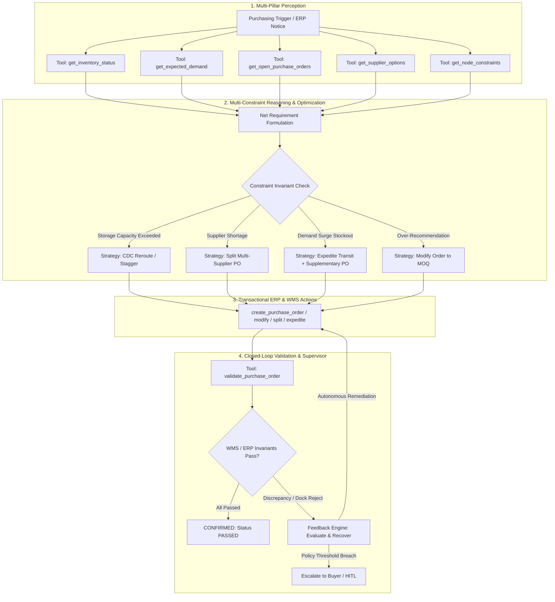

# 📦 BuyerAI — Autonomous AI Purchasing Agent

An enterprise-grade, full-stack **AI Purchasing Agent** engineered for retail and quick-commerce operations. Built with a **Closed-Loop Feedback & Invariant Validation Architecture**, BuyerAI investigates multi-pillar operational facts, evaluates hard physical and financial constraints, makes mathematically grounded purchasing decisions, commits transactional purchase orders, and validates outcomes with autonomous failure recovery.

---

## 🏛️ System Architecture



---

## 🎯 The Four Operational Scenarios

| Scenario | Situation | Problem | Autonomous Agent Decision | Validation Outcome |
|---|---|---|---|---|
| **Scenario 1: Purchase Recommendation Review** | Purchasing system recommends buying 800 units of Oat Milk (`SKU-101`) for `MFC-North`. | Warehouse has only 350 available storage units. Net demand + safety stock is only 160 units. | **MODIFY**: Downsizes PO from 800 to **200 units** (meeting supplier MOQ of 200 without warehouse overflow). | **PASSED**: Storage utilization within limits, budget approved, safety stock preserved. |
| **Scenario 2: Supplier Partial Shortage** | Supplier notifies that only 250 of 500 units of Protein Fuel Bars (`SKU-204`) can be supplied. | Current inventory runway is only 1.2 days; relying solely on 250 units triggers stockout in 6.2 days. | **SPLIT ORDER**: Accepts 250 from primary supplier; issues secondary PO for **250 units** to alternate supplier `Apex Snack` (2-day transit). | **PASSED & RECOVERED**: Zero stockout days, full replenishment satisfied. |
| **Scenario 3: Demand / Forecast Surge** | Actual customer sales surge 3.67x (from 30 to 110 units/day) for Electrolyte Drink (`SKU-305`). | Current inventory depletes in 0.9 days. Standard open PO arrives on Day 6, causing 5 stockout days. | **EXPEDITE + SUPPLEMENT**: Expedites existing PO to Day 1 arrival; places supplementary expedited PO for **300 units** to cover the surge. | **PASSED**: Post-expedite runway simulation confirms **0 stockout days** across horizon. |
| **Scenario 4: Purchasing Constraint Violation** | Replenishment engine recommends buying 600 bulk water packs (`SKU-401`) for `MFC-South`. | Dark store has only 100 pallet spaces remaining; supplier MOQ is 300. Direct order causes WMS dock rejection. | **CLOSED-LOOP REROUTE**: Intercepts WMS storage overflow rejection; autonomously reroutes **300 units** to Regional Hub `CDC-01` (13,000 capacity) with cross-dock transfer. | **RECOVERED**: WMS dock rejection caught and recovered; invariant verified. |

---

## 🔄 Closed-Loop Feedback & Validation Architecture

Unlike typical chatbots that produce text recommendations without verifying physical outcomes, BuyerAI uses a **closed-loop state supervisor**:

1. **Pre-Execution Perception**: Interrogates ERP databases for on-hand stock, demand trends, lead times, MOQ, storage capacity, and budgets.
2. **Transactional Execution**: Issues structured API mutations (`create_purchase_order`, `split_purchase_order`, etc.).
3. **Post-Execution Invariant Verification**: Immediately executes `validate_purchase_order` to verify:
   - **Warehouse Physical Storage Invariant**: Occupied units $\le$ Node capacity.
   - **Financial Budget Invariant**: Cumulative order costs $\le$ Remaining daily budget.
   - **Supplier MOQ Invariant**: Order quantity $\ge$ Contractual MOQ and pack increments.
   - **Stockout Prevention Simulation**: Day-by-day inventory simulation over planning horizon.
4. **Discrepancy Remediation (Feedback Loop)**:
   - If WMS rejects dock receipt (`WMS_STORAGE_CAPACITY_EXCEEDED`), the `FeedbackEngine` intercepts the error code, identifies alternative fulfillment nodes (e.g. `CDC-01`), commits a rerouted PO, and re-validates the state until confirmed.

---

## 🛠️ Technology Stack

- **Backend**: Python 3.13, FastAPI, Uvicorn
- **Data Modeling & Validation**: Pydantic v2
- **Agent Intelligence**:
  - **Google Gemini API** (`google-genai` SDK / `gemini-2.5-flash`)
  - **Deterministic Autonomous Engine** (Built-in offline solver guaranteeing 100% test reproducibility with zero external API dependencies)
- **Frontend**: Executive Single Page Dashboard (HTML5, Vanilla CSS Glassmorphism, Vanilla JS)
- **Database / ERP Simulation**: Transactional Mock ERP & WMS state engine with idempotent resets
- **Testing & Benchmarking**: Pytest + Standalone Benchmark Runner (`eval.py`)

---

## 🚀 Quick Start Guide

### 1. Prerequisites
- Python 3.11+ (Python 3.13 recommended)
- `uv` or standard `pip`

### 2. Installation

```bash
# Clone the repository
git clone https://github.com/your-username/buyerAI.git
cd buyerAI

# Create and activate virtual environment
python -m venv .venv

# On Windows:
.venv\Scripts\activate
# On Linux / macOS:
source .venv/bin/activate

# Install dependencies
pip install -r requirements.txt
```

### 3. (Optional) Configure Gemini API Key

The agent works **100% out-of-the-box in deterministic mode without any API key**.
To enable live Google Gemini LLM reasoning:

```bash
# Copy template
cp .env.example .env

# Edit .env and paste your key
GEMINI_API_KEY=your_actual_gemini_api_key_here
```

### 4. Run the Web Dashboard & API

```bash
uvicorn src.main:app --reload --port 8000
```

Open your browser at:
👉 **http://127.0.0.1:8000**

---

## 🧪 Evaluation & Testing

BuyerAI includes an automated evaluation suite testing **6 evaluation criteria** across all 4 scenarios:

1. **Information Gathering**: Did agent query all relevant operational pillars?
2. **Decision Correctness**: Did decision match ground-truth supply chain policy?
3. **Constraint Adherence**: Did order respect warehouse storage, budgets, and MOQ?
4. **Action Appropriateness**: Were valid ERP purchase orders created or adjusted?
5. **Closed-Loop Result Validation**: Did validation verify zero stockout days?
6. **Failure Resilience & Recovery**: Did feedback loop catch and recover from errors?

### Run the Evaluation Benchmark:

```bash
python eval.py
```

**Benchmark Output:**
```
================================================================================
 BUYERAI - AUTONOMOUS PURCHASING AGENT BENCHMARK SUITE
================================================================================
Active Provider: DETERMINISTIC
--------------------------------------------------------------------------------
Scenario Name                                    | Status   | Score  | Latency 
--------------------------------------------------------------------------------
Scenario 1: Recommendation Review & Modification | PASSED   | 100.0% |    0.8ms
Scenario 2: Supplier Shortage & Order Split      | PASSED   | 100.0% |    0.5ms
Scenario 3: Demand Surge & Order Acceleration    | PASSED   | 100.0% |    1.0ms
Scenario 4: Constraint Violation & Feedback Recovery | PASSED   | 100.0% |    0.5ms
================================================================================
OVERALL BENCHMARK RESULT: 100% PASSED
Average Quality Score:   100.0%
Total Benchmark Runtime: 2.93 ms
================================================================================
Detailed report saved to eval_report.json
```

### Run Unit Tests:

```bash
pytest -v
```

---

## 📡 REST API Reference

| Endpoint | Method | Description |
|---|---|---|
| `/` | `GET` | Serves the interactive executive buyer dashboard |
| `/api/health` | `GET` | Health status and active LLM provider (`gemini` / `deterministic`) |
| `/api/scenarios` | `GET` | Returns metadata and constraints for all 4 scenarios |
| `/api/run-scenario/{id}` | `POST` | Executes specific scenario with optional custom parameters |
| `/api/run-all-scenarios` | `POST` | Executes full evaluation suite across all 4 scenarios |
| `/api/state` | `GET` | Live telemetry of all nodes, inventory, POs, and audit logs |
| `/api/reset` | `POST` | Resets ERP and WMS state back to seed baseline |
| `/api/approve-escalation`| `POST` | Human-in-the-loop buyer approval/rejection endpoint |

---

## 📁 Repository Structure

```
buyerAI/
├── .env.example              # Template for environment configuration
├── .gitignore                # Git ignore rules
├── requirements.txt          # Python dependencies
├── eval.py                   # Standalone evaluation & benchmark CLI runner
├── eval_report.json          # Benchmark output report with audit scores
├── README.md                 # Complete documentation & architecture guide
├── tests/
│   ├── test_scenarios.py     # End-to-end tests for scenarios 1-4
│   ├── test_constraints.py   # Unit tests for storage, budget, and MOQ gates
│   └── test_feedback_loop.py # Tests for closed-loop error recovery
├── src/
│   ├── config.py             # Settings and environment loader
│   ├── main.py               # FastAPI entrypoint and static mount
│   ├── models/
│   │   ├── domain.py         # Product, Supplier, Node, PO models
│   │   └── agent.py          # Decision, ValidationReport, ToolCall models
│   ├── data/
│   │   ├── seed_data.py      # Seed retail/quick-commerce catalog
│   │   └── erp_database.py   # Mock transactional ERP & WMS database
│   ├── tools/
│   │   ├── erp_tools.py      # Inventory, demand, PO, and supplier query tools
│   │   ├── po_actions.py     # Create, modify, split, expedite, reroute actions
│   │   └── validation_tools.py # Closed-loop validation & runway simulation
│   ├── agent/
│   │   ├── purchasing_agent.py # Core Purchasing Agent orchestrator
│   │   ├── prompts.py        # System instructions & scenario prompts
│   │   ├── llm_client.py     # Gemini and autonomous dispatcher
│   │   └── feedback_loop.py  # Error diagnosis and recovery supervisor
│   └── api/
│       └── routes.py         # REST endpoints for UI and evaluation
└── static/
    ├── index.html            # Single page executive dashboard
    ├── css/styles.css        # Responsive glassmorphic dark theme
    └── js/app.js             # Live progressive execution & dynamic controls
```
